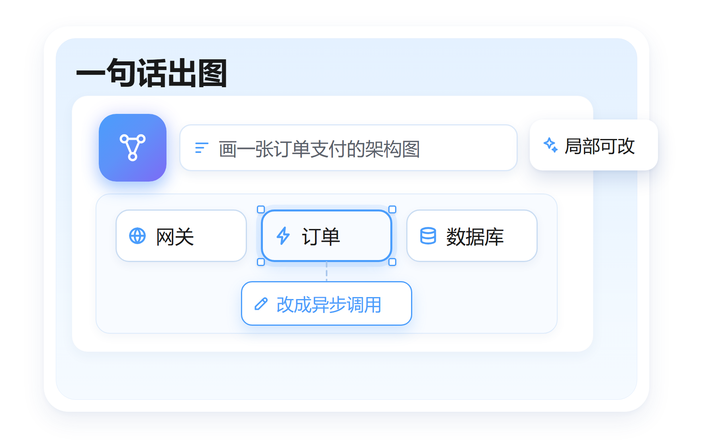
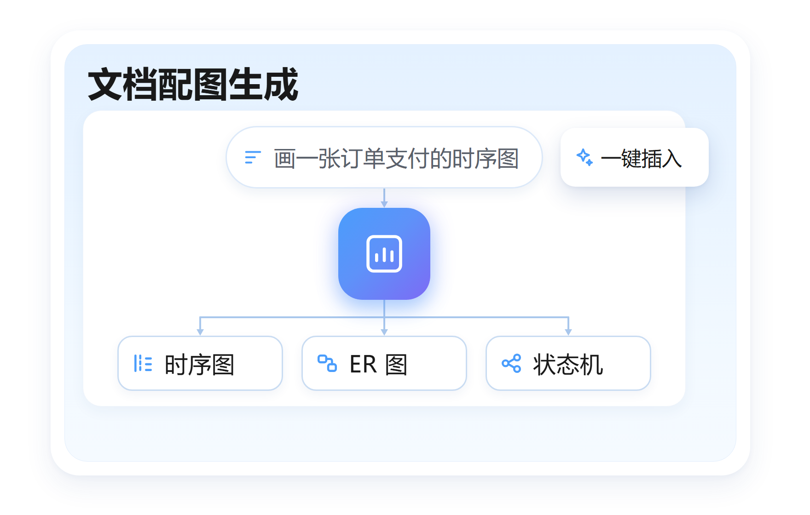
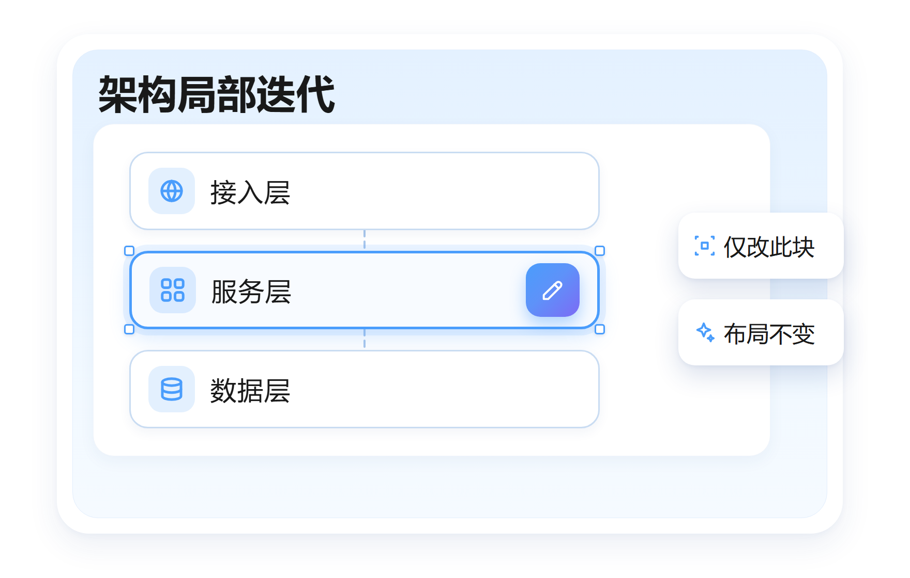

# 产品场景图生成器

**Product Scenario Illustration Kit** — 一套用 HTML/CSS 复刻的「扁平矢量 UI 示意图」视觉系统。
给一个标题，产出一张 1760×1120 的场景图；同一个标题反复生成，结果完全一致。




---

## 这是什么

一组风格统一的产品功能配图，加上**把这组图复刻出来所需的全部东西**：色值与几何的 token 表、三种版式骨架、可直接改的 HTML 模板、一个零依赖的渲染脚本，以及一个给 AI Agent 用的 skill。

它解决的是很具体的问题：一个产品有二十个功能点，要做二十张风格一致的配图放进 PPT、官网和产品文档。找设计师太慢，用 AI 生图每次风格都不一样、中文还会糊。于是把风格**固化成代码**——模板只有一套壳，内容随便换，出来的图永远属于同一个家族。

| 项 | 值 |
|---|---|
| 输出尺寸 | 1760 × 1120（11:7） |
| 实际观看尺寸 | 常被放进网页卡片，缩到 **240px 宽**（按这个尺寸设计） |
| 技术栈 | HTML + CSS + 内联 SVG |
| 渲染器 | Edge / Chrome / Chromium headless |
| 依赖 | **无**（`render.py` 只用 Python 标准库） |
| 单张耗时 | 约 2 秒 |

## 效果

**v2 · 卡片式** —— 每个概念一张圆角卡片 + 短标签，适合需要逐条并列讲清的场合。

<table>
<tr>
<td width="33%"><br><sub><b>左→右流程 + 四联输出</b><br>一句话生成时序图/ER 图/状态机/拓扑图</sub></td>
<td width="33%"><br><sub><b>界面隐喻 · 选中态</b><br>只改一块，其余布局与样式不动</sub></td>
<td width="33%"><br><sub><b>界面隐喻 · 画布编辑</b><br>自然语言生成 + 局部修改</sub></td>
</tr>
</table>

**v3 · 图形化** —— 去掉内容白卡，图标放大三倍，让图形自己承担语义；文字只剩标题 + 2–3 字标签 + 浮标。

<table>
<tr>
<td width="50%"><br><sub><b>核心分支 · 三张错位叠页</b><br>一个中心能力辐射四类产出，中心本身是图形装置而非图标</sub></td>
<td width="50%"><br><sub><b>圆形流水线 · 三步串联</b><br>中间那块是唯一渐变体，也是读者的第一落点</sub></td>
</tr>
</table>

五张图不是手绘的，也不是 AI 生图，是 `examples/src/` 和 `skill/hwcloud-scene-image/assets/` 里的 HTML 被浏览器渲染出来的。改一行文字、重新渲染，就得到新的一张。

v3 的两套版式由一套可复用资产拼出来：**50 枚线性图标**（`assets/icons.svg`）+ **15 件图形零件**（`assets/parts.html`，渐变瓦片、白圆徽章、层堆叠、环形进度、指令气泡、微柱图……），零件墙上每件都标了 class 名和尺寸，照着抄即可。

## 两套取向

| | v2 · 卡片 | v3 · 图形化 |
|---|---|---|
| 主体 | 圆角矩形节点 + 短标签 | 大图标 / 圆形节点 / 图形装置 |
| 内容区 | 整块白色 content 卡 | **没有**，图形直接浮在淡蓝面板上 |
| 图标 | 46–54px | 84–190px |
| 文字 | 5–7 处，每处 2–4 字 | 3–4 处，每处 2–3 字 |
| 边界 | 3px 描边 | 阴影优先，能不用描边就不用 |

v3 不是"更花哨的 v2"，它换的是**信息载体**：v2 用文字标签讲概念，v3 让图形自己说。
代价是能承载的要点变少（≤4 个），收益是缩到 240px 后反而更清楚——色块和形状比 6px 的字更抗缩放。

## 风格特征

一句话定性：**扁平矢量 UI 示意图**。用卡片层叠造深度、用渐变图标瓦片承载主体、用虚线表达流程、用骨架条代替真实内容。**无人物、无透视、无照片质感。**

| 维度 | 特征 |
|---|---|
| **构图** | 三层嵌套卡片逐层向右下偏移 8–14px（唯一的深度来源）+ 1–2 个破框浮标 |
| **配色** | 色相锁死 200°–250°，主蓝 `#4A9DFC`、紫端 `#7C6BF5`；唯一暖色 `#F58A8A` 只表告警 |
| **光影** | 无方向性光源、无高光、无 AO；只有三级层高投影，色是**深蓝** `rgba(31,71,141,…)` 而非黑 |
| **材质** | 全哑光平涂；唯一"实体感"是渐变图标瓦片 |
| **视角** | 严格正交正视 0° 透视，所有矩形轴对齐 |
| **氛围** | 洁净、克制、可信 —— 企业级 SaaS 技术说明书气质，讲"怎么运作"而非"多酷" |
| **密度** | 中低，一图一件事；内容区元素 **≤ 7 个** |
| **可读性** | 按 **240px 观看**设计：字号 ≥40px，缩到卡片尺寸后每个标签的大意仍读得出 |

完整的分析见 [`docs/style-guide.html`](docs/style-guide.html)（可视化版，10 节：结构剖面、版式骨架、色卡面积占比、9 个零件实物复刻、标题→版式映射、提示词模板、自检清单）——克隆后双击用浏览器打开；精简可执行版见 [`docs/style-spec.md`](docs/style-spec.md)。

## 为什么用 HTML 渲染，而不是 AI 生图

这类图有三个硬指标，扩散模型目前都过不了：

1. **文字必须清晰**。「接入层」「一句话生成」这类标签是信息主体，生图会画成伪文字；
2. **1px 描边必须直**。模型画出来的卡片边缘会抖、圆角会不圆；
3. **必须可复现**。同一标题今天生成和下周生成要一模一样，才好批量维护。

HTML 渲染把这三件事都变成确定性的：文字是真文字、描边是真 1px、结果是代码的函数。代价是需要一次性把版式搭出来——而这一步已经做完了。

> AI 生图仍然有用：做无文字的氛围底图、做封面插画。但主体示意图建议走本项目的渲染管线。

## 项目结构

```
.
├── README.md
├── LICENSE
├── .gitignore
├── docs/
│   ├── style-spec.md            # 可执行规范：token 表 + 标题→版式映射 + 自检
│   └── style-guide.html         # 可视化风格指南（浏览器打开）
├── examples/
│   ├── 01-document-diagram-generation.png
│   ├── 02-architecture-evolution.png
│   ├── 03-diagram-canvas.png
│   ├── 04-orbit-four-diagrams.png      # v3 核心分支
│   ├── 05-circle-pipeline.png          # v3 圆形流水线
│   └── src/
│       ├── 01-document-diagram-generation.html
│       ├── 02-architecture-evolution.html
│       └── 03-diagram-canvas.html
├── skill/
│   └── hwcloud-scene-image/     # 给 AI Agent 用的 skill（见下）
│       ├── SKILL.md
│       ├── references/
│       │   ├── style-tokens.md  # 色值/字号/圆角/投影完整表（含 v3）
│       │   ├── layouts.md       # 五种版式骨架 + 元素配方
│       │   └── checklist.md     # 交付前自检（含 v3 专用项）
│       ├── assets/
│       │   ├── icons.svg               # 50 枚线性图标 sprite
│       │   ├── parts.html              # 15 件图形零件墙
│       │   ├── template-d-orbit.html   # D 核心分支（v3）
│       │   ├── template-e-pipeline.html# E 圆形流水线（v3）
│       │   ├── _blank-shell.html       # 只有壳层，从零搭版式用
│       │   ├── template-b-flow.html    # B 上→下分叉（v2）
│       │   ├── template-c-ui.html      # C 界面隐喻·画布编辑（v2）
│       │   └── template-c-arch.html    # C 界面隐喻·选中态（v2）
│       └── scripts/
│           ├── render.py        # HTML → 1760×1120 PNG
│           ├── linklint.py      # 检查每根连线的端点是否悬空
│           ├── preview.py       # 生成 240px 缩略图用于自检
│           └── iconlib.py       # 列图标 id / 生成图标墙
└── samples/                     # 原始参考样本（未随仓库分发，原因见文末）
```

## 快速开始

**环境**：Python 3.7+，本机装有 Edge / Chrome / Chromium 任意一个。不需要 `pip install`。

```bash
git clone <your-repo-url>
cd <repo>
```

### 1. 复制一份模板

```bash
cp skill/hwcloud-scene-image/assets/template-c-ui.html my-scene.html
```

### 2. 改文字

打开 `my-scene.html`，只需要改这几处：

```html
<div class="title">智能图表绘制</div>
                          <!-- ↑ 4–6 个汉字，别照搬长标题 -->
```

```html
<div class="txt">画一张订单支付的架构图，包含网关、服务与数据库</div>
                          <!-- ↑ 换成真实例句，不要写"示例文本" -->
```

```html
<div class="badge" style="top:526px;">
  ...
  <div class="txt">一句话生成</div>
                          <!-- ↑ 4–6 字，动词开头或承诺句 -->
</div>
```

**壳层 CSS 一行都不要动**——`.shell` / `.panel` / `.content` 的坐标就是这套风格的骨架。

### 3. 渲染

```bash
python skill/hwcloud-scene-image/scripts/render.py my-scene.html out.png
```

```
[1/5] 浏览器: C:\Program Files (x86)\Microsoft\Edge\Application\msedge.exe
[2/5] 临时目录: C:\_scene_zt4t6dsw
[3/5] 渲染中 …
[4/5] 输出: out.png  1760x1120  90 KB
[5/5] 检查连线 …
linklint: my-scene.html  —  7 条线，10 个实体
    所有端点都接上了
```

脚本会先把 HTML 复制到**纯 ASCII 临时目录**再截图——浏览器 headless 在中文路径下会静默失败、输出空白或旧图，这是踩过的坑。渲染完会校验像素尺寸，然后再跑一遍连线检查（见下节）。

### 4. 连线检查（不要跳过）

```bash
python skill/hwcloud-scene-image/scripts/linklint.py my-scene.html
```

连线是全图唯一需要手写绝对坐标的部分，也因此最容易出错。这个脚本让浏览器算出每根线的真实端点，逐个判断它是否**贴着某个元素边缘**（≤8px）或**与另一条线相交**（≤3px），不满足就是悬空：

```
[x] 发现 1 个悬空端点：
    第6条线 起点 在 (1235,690)，最近的物体还差 40px  d="M1235 690 V716"
```

退出码非 0 就不要交付。为什么必须靠机器查：一段缺失 800px 的横线，在 1760 原图上看着完全正常，缩到 240px 更是彻底消失——它只在几何上存在，不在视觉上存在。

`render.py` 已经自动调用它，有断线时退出码为 3，但**PNG 仍然会输出**，所以「图生成了」不等于「图没问题」。

### 5. 按 240px 验收

```bash
python skill/hwcloud-scene-image/scripts/preview.py out.png --width 240
```

打开生成的 `out_preview.png` 判断：标题、每个标签的大意、重点块，还读得出来吗？
**读不出就回去减元素、放大字号**——这一步比看 1760 原图重要。

浏览器不在默认位置时：

```bash
SCENE_BROWSER=/path/to/chrome python scripts/render.py in.html out.png
```

## 用 AI Agent 直接出图

`skill/hwcloud-scene-image/` 是一个标准 Agent Skill。装好之后，你只需要说一句「帮我画：XXX」，Agent 会自己选版式、套模板、渲染、自检。

> Skill 已独立成一个仓库，可以直接装、不用克隆整个项目：
> **[sunhaha369369/hwcloud-scene-image-skill](https://github.com/sunhaha369369/hwcloud-scene-image-skill)**。
> 下面的 `skill/hwcloud-scene-image/` 与它内容一致，保留在此便于对照规范文档。

**安装**（WorkBuddy / Claude Code 等支持 Skill 的环境）：

```bash
# 方式一：直接用独立仓库（推荐）
git clone https://github.com/sunhaha369369/hwcloud-scene-image-skill.git \
  ~/.workbuddy/skills/hwcloud-scene-image

# 方式二：从本仓库复制
cp -r skill/hwcloud-scene-image ~/.workbuddy/skills/
```

放好后重启会话，skill 会被自动索引。

**触发词**：场景图、产品场景图、功能场景图、示意图、配图、卡片式示意图、扁平矢量插画。

**Agent 拿到的内容**：

- **SKILL.md** — 铁律 10 条、固定几何坐标表、5 步工作流、6 个元素零件、连线画法、常见错误
- **style-tokens.md** — 所有色值、字号、圆角、投影的精确值
- **layouts.md** — 三种版式的 ASCII 骨架图 + 元素配方 + 怎么选
- **checklist.md** — 交付前逐条核对（第 -1 条机器判连线，第 0 条硬门槛是 240px 缩略可读）
- **3 套可直接运行的模板** + 1 个空白壳层
- **render.py / linklint.py / preview.py** — 渲染、连线检查、缩略预览
- **SKILL.md 里的「连线怎么画才不会断」**：分叉拆成「枢纽 + 独立段」，每段一条 path，端点级重合

关键是**固定几何写死在文档里**：`shell 110,66,1520×968`、`panel 140,96,1460×908`、`content 180,240,1310×644`、`badge left 1312 宽 320 右缘 1632 破框`。不同 Agent、不同会话、不同时间，出来的图坐标完全一致。

## 风格 Token 速查

### 几何

| 层 | 元素 | left | top | w × h | 圆角 |
|---|---|---|---|---|---|
| L1 | 外壳白卡 | 110 | 66 | 1520 × 968 | 62 |
| L2 | 淡蓝面板 | 140 | 96 | 1460 × 908 | 50 |
| L3 | 内容白卡 | 180 | 240 | 1310 × 644 | 40 |
| L4 | 破框浮标 | 1312 | 自定 | 320 × 128 | 32 |
| – | 标题 | 190 | 132 | – | 76px / 600 |

### 主色

| 角色 | 值 |
|---|---|
| 主蓝 / 渐变起点 | `#4A9DFC` |
| 渐变紫端 | `#7C6BF5` |
| 面板渐变 | `#E4F1FF → #E9F4FF → #F2F9FF → #F5FAFF` |
| 节点描边 | `#C9DCF2`（3px） |
| 连线 / 箭头 | `#A9C7EC`（4px） |
| 骨架条（可选装饰） | `#D9E7FA` |
| 文字主 / 次 / 弱 | `#191919` / `#5A616B` / `#71808F` |
| 告警（唯一暖色） | `#F58A8A` |

### 投影

```css
/* 一级：小控件 */ box-shadow:0 4px 12px rgba(31,71,141,.045);
/* 二级：内容卡 */ box-shadow:0 8px 24px rgba(31,71,141,.05);
/* 三级：外壳   */ box-shadow:0 22px 60px rgba(31,71,141,.085), 0 4px 14px rgba(31,71,141,.04);
/* 浮标（最重）*/ box-shadow:0 18px 44px rgba(31,71,141,.15), 0 3px 8px rgba(31,71,141,.05);
/* 渐变瓦片   */ box-shadow:0 16px 34px rgba(74,157,252,.40), 0 0 34px 6px rgba(124,107,245,.16);
```

投影色永远是深蓝，不是黑——这是整张图"干净而不脏"的原因。

## 三种版式怎么选

| 标题特征 | 版式 | 模板 |
|---|---|---|
| 输入→生成→产出、转换、整理、多路输出 | **B 左→右流程** | `template-b-flow.html` |
| 既讲"一句话生成"又讲"生成后能改" | **C 界面隐喻 · 画布编辑** | `template-c-ui.html` |
| 只改一处、其余不动、增量演进 | **C 界面隐喻 · 选中态** | `template-c-arch.html` |
| 一个中心服务 N 个场景 | **A 中心辐射** | 用 `_blank-shell.html` 自搭 |

拿不准就选 C 画布版——界面隐喻最容易读懂，也最不容易画歪。

## 元素零件

| # | 零件 | 关键参数 |
|---|---|---|
| 1 | 渐变图标瓦片 | 170–200px 见方，135° `#4A9DFC→#7C6BF5` + 白色线性图标 + 下缘柔光；**全图恰好 1 个** |
| 2 | 破框浮标 | `320×128`，白底 + 重投影 + 46px 蓝图标 + 44px 文字，越过卡片右缘 |
| 3 | 层条 / 节点 | `910×152` 宽层条或 `330×132` 节点，3px 描边 + 90px 淡蓝图标块 + **48–50px 真实短标签** |
| 4 | 虚线连接 | `4px / #A9C7EC / dash 12 10`，箭头用**等腰三角**，不能用直角三角形 |
| 5 | 选中态 | `5px #4A9DFC` + 12px 光晕 + 四角 20px 手柄（中心对准角点）；**不要画虚线选择框** |
| 6 | 指令气泡 | 在选中节点下方，用 4px 虚线相连（连线 svg 需 `z-index:6`，否则被光晕盖住） |
| 7 | 画布底板 | `#F8FBFF / 2px #DDEBFB / r36`，把"节点 + 气泡"收成一组，避免画面散 |
| 8 | 骨架条 | 只在"还有更多内容"时用 1 条 `h20 / r10 / #D9E7FA`；**不要用它模拟文字** |

## 常见坑

| 现象 | 原因 | 修法 |
|---|---|---|
| 底部一条白带，面板像只有边框 | 渐变淡到 `#FBFCFE` | 止于 `#F5FAFF` |
| 蓝色带太窄，整图发闷 | 内容卡太高 | h 收到 620–660，底部留 100–140px |
| 缩略后糊成一片灰 | 元素太小、太多 | 元素 ≤7 个；字号 ≥48px；节点 ≥330×132；描边 3px |
| 细骨架条缩略后是灰斑 | 用骨架条承载信息 | 换成真实短标签（2–4 字） |
| 气泡虚线看不见 | 被选中节点光晕盖住 | 给连线 svg 加 `z-index:6` |
| 手柄浮在角外 | 手写 top 没减半 | `handle.left = 角点 x − 10` |
| 上排 3 块中排 2 块，中间一条横线像分割线 | 汇聚总线横穿全宽 | 上下严格垂直对齐（2-2-1），只汇一次 |
| 虚线选择框被连线穿过 | 框跨越了层间连线 | 去掉虚线框，只留四角手柄 |
| 图层标签和节点没对齐 | 手写了 `top` | `label top = 节点 top + 节点高/2 − 13` |
| 箭头歪、像直角三角形 | 路径写错 | 向下 `M265 170 h14 l-7 12 z`，向右 `M456 219 l12 7 l-12 7 z` |
| 渲染出来空白或旧图 | HTML 在中文路径下 | 用 `render.py`，它复制到 ASCII 目录 |
| **连线断在半路，肉眼看不出来** | 一条 path 转弯后只覆盖部分支线 | 拆成「枢纽 + 独立段」，跑 `linklint.py` |
| 浮标压住内容 | 内容卡过宽 | 内容卡宽 1310，右侧留 146–270px 给浮标 |

## 关于原始样本

本项目的风格来自对 **4 个产品线共 14 张原始场景图**的逆向分析（比例、取色、层叠偏移、元素频次都做了实测）。

这些原始图**版权归原权利方，未随仓库分发**，因此 `samples/` 已加入 `.gitignore`。风格规范、token 表、模板与示例图都是基于这些分析独立重写的，可以自由使用。

如果你拥有这些素材的授权、想一并发不出来：

```bash
git add -f samples/
```

## 二次开发

- **换配色**：只改 `:root` 之外的三个值——主蓝 `#4A9DFC`、紫端 `#7C6BF5`、面板渐变首尾。保持 135° 渐变方向和"深蓝投影"两条不变，家族感就不会丢。
- **加版式**：用 `_blank-shell.html` 起手，壳层不动，在 `.content` 区域内用绝对坐标摆零件。内容区原点 = `(180, 240)`。
- **批量出图**：写个脚本遍历标题列表 → 替换模板文本 → 调 `render.py`。模板是纯文本，用字符串替换或 Jinja2 都行。
- **改尺寸**：不建议。11:7 + 1760×1120 是这套图的比例基因，所有坐标都按它算好了。

## Roadmap

- [x] 14 张样本的风格逆向分析与 token 提取
- [x] 三种版式骨架 + 8 个元素零件
- [x] 零依赖渲染脚本（自动探测浏览器 / ASCII 路径 / 尺寸校验）
- [x] Agent Skill 封装
- [x] **v2：按 240px 观看重新标定**（字号 ×2、元素数 ÷3、缩略可读验收脚本）
- [ ] 版式 A（中心辐射）完整模板
- [ ] 一键批量：`titles.txt` → 一批 PNG
- [ ] SVG 输出（当前只有 PNG，矢量版可无损缩放）
- [ ] 深色模式 token

## 贡献

欢迎提 Issue / PR。提交新模板时请附上渲染结果，并确保通过 `skill/hwcloud-scene-image/references/checklist.md` 的 12 条自检。改动 token 的 PR 需要说明为什么原值不够用——这套系统的价值就在"不变"。

## License

[MIT](LICENSE) © 2026

本项目为独立实现的视觉风格系统，与华为技术有限公司无关，未使用其任何官方设计资源。文中提及的产品名称仅用于说明风格来源。

<details>
<summary><b>English</b></summary>

A flat-vector, card-layered product-illustration system rendered with plain HTML/CSS/SVG. Give it a title, get a 1760×1120 PNG — deterministic, pixel-stable, Chinese text always crisp.

- **Stack**: HTML + CSS + inline SVG, rendered by headless Edge/Chrome. `render.py` uses only the Python standard library.
- **Style**: 3 nested rounded cards offset down-right, one 135° blue→violet gradient tile as the hero, light-blue dashed connectors, skeleton bars instead of real copy, 1–2 badges breaking the card edge, strict 0° perspective, no people, no photos.
- **Why not a diffusion model**: precise labels, 1px strokes, and reproducibility are hard requirements here.
- **Agent skill**: `skill/hwcloud-scene-image/` — copy it into `~/.workbuddy/skills/` and ask "draw me: …".

```bash
cp skill/hwcloud-scene-image/assets/template-c-ui.html my-scene.html
# edit .title, .prompt .txt, .badge .txt
python skill/hwcloud-scene-image/scripts/render.py my-scene.html out.png
```

</details>
