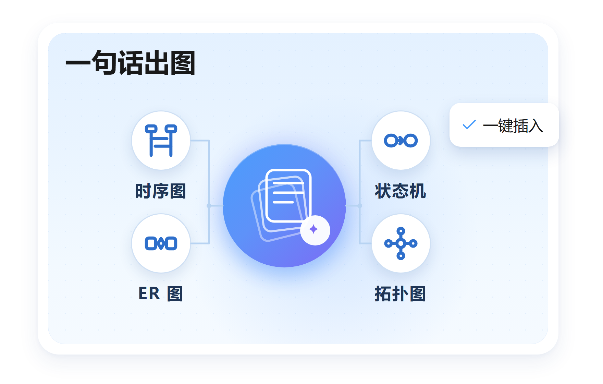

# 产品场景图生成器 · 图形化

**Product Scenario Illustration Kit** — 用**图标和图形元素**承载语义的扁平矢量示意图系统。
给一个标题，产出一张 1760×1120 的场景图；同一个标题反复生成，结果完全一致。




---

## 这是什么

一套**图形化取向**的产品配图系统：把风格固化成代码，内容随便换，出来的图永远属于同一个家族。

它和常见的"卡片 + 标签"示意图有一个根本区别——**信息不由文字块承担**。一个中心图形装置、四个白色圆形徽章、一组渐变箭头，图形本身就把结构说完了；文字只剩标题、2–3 字的标签和一句浮标。缩到网页卡片大小时，形状和色块比 6px 的小字更抗缩放。

| 项 | 值 |
|---|---|
| 输出尺寸 | 1760 × 1120（11:7） |
| 实际观看尺寸 | 常被放进网页卡片，缩到 **240px 宽**（按这个尺寸设计） |
| 技术栈 | HTML + CSS + 内联 SVG |
| 渲染器 | Edge / Chrome / Chromium headless |
| 依赖 | **无**（`render.py` 只用 Python 标准库） |
| 图形资产 | **50 枚线性图标** + **15 件图形零件** |
| 单张耗时 | 约 2 秒 |

## 三条设计原则

**1. 不铺内容白卡。** 图形直接落在淡蓝面板上，白底只留给徽章和浮标这类小件。整块白色内容区会立刻把画面切成"框里装东西"，这是"框框感"的主要来源。这条最反直觉，也最有效。

**2. 图标放大到 84–190px。** 小图标是装饰，大图标才是语义。形状语言也随之从圆角矩形转向圆——圆没有边框，不需要描边，天然融入背景。

**3. 文字退为注脚。** 全图 3–4 处文字，每处 2–3 字。省下的信息量交给图形。代价是能承载的要点变少（≤4 个），收益是缩略后反而更清楚。

> 边界也要说清：如果标题有 5–6 条必须逐条读字的并列项，图形化装不下这么多信息，硬塞会既不清楚也不好看——那类标题不适合这套版式。

## 效果

**D · 核心分支** —— 一个中心能力辐射四类产出。中心不是图标，是"三张错位叠放的图页 + 右下角星芒"的图形装置。


**E · 圆形流水线** —— 2–4 步串联。三圆等距，箭头嵌在间隙里，中间那块是唯一渐变体，也是读者的第一落点。


两张图都不是手绘的，也不是 AI 生图，是 `skill/hwcloud-scene-image/assets/` 里那两个模板被浏览器渲染出来的：`template-d-orbit.html` → 04，`template-e-pipeline.html` → 05。改一行文字、重新渲染，就得到新的一张。

## 图形资产

图形化的前提是**有图可用**。仓库里备好了两套资产，拼装即可，不需要现画。

### 图标库 · `assets/icons.svg`

50 枚线性图标，24×24 网格，统一 1.6 视觉基调、圆头圆角、吃 `currentColor`：

| 分组 | 数量 | 内容 |
|---|---|---|
| 图表 / 图示 | 12 | 时序图 `i-sequence`、ER 图 `i-er`、状态机 `i-state`、拓扑 `i-topology`、流程 `i-flow`、树 `i-tree`、看板 `i-kanban`、时间轴 `i-timeline`、柱 / 线 / 饼 `i-chart-*`、九宫格 `i-grid` |
| 技术元素 | 15 | 终端 `i-terminal`、代码 `i-code`、数据库 `i-database`、云 `i-cloud`、服务 `i-server`、CPU `i-cpu`、分支 `i-branch`、合并 `i-merge`、盾 `i-shield`、锁 `i-lock`、闪电 `i-zap`、时钟 `i-clock`、图层 `i-layers`、立方 `i-box`、窗口 `i-window` |
| AI / 内容 | 23 | 星芒 `i-sparkles`、魔棒 `i-wand`、机器人 `i-bot`、灯泡 `i-bulb`、文档 `i-doc`、书 `i-book`、图片 `i-image`、链接 `i-link`、火箭 `i-rocket`、刷新 `i-refresh`、勾 `i-check`… |

```bash
python skill/hwcloud-scene-image/scripts/iconlib.py --list          # 按分组列出全部 id
python skill/hwcloud-scene-image/scripts/iconlib.py --preview w.png # 生成图标墙，挑图用
```

**线宽必须按显示尺寸配。** symbol 里刻意不写 `stroke-width`——24 网格放大到 176px 时，写死的 1.6 会变成 12px 的粗描边。视宽公式：

```
视觉线宽 = stroke-width × 显示尺寸 / 24
```

| 显示尺寸 | 建议 stroke | 视觉线宽 | 典型位置 |
|---|---|---|---|
| 52px | 1.8 | ~3.9px | 浮标内小图标 |
| 108px | 2.0 | ~9px | D 版式的卫星徽章 |
| 132px | 1.5 | ~8.3px | E 版式的圆形节点 |
| 132px（白图标） | 1.3 | ~7.2px | 渐变底上的图标要更细 |

目标区间 **7–9px**，缩到 240px 时约 1px，细而不虚。

> ⚠️ **sprite 必须整段内联**。`<use href="icons.svg#i-database">` 这种外部引用在 `file://` 下会被浏览器按跨域拦掉，结果是图标整片消失且**不报错**。模板里已经把 50 枚 symbol 内联在页面底部，直接复用。

### 零件墙 · `assets/parts.html`

15 件图形零件，每件都标了 class 名和尺寸，浏览器打开即可见，直接抄 HTML + CSS：

| 零件 | class | 关键参数 |
|---|---|---|
| 渐变瓦片 | `.tile-grad` | 170–200px 见方 / r44 / 135° `#4A9DFC→#7C6BF5`；**全图恰好 1 个** |
| 白圆徽章 | `.sat` `.badge-c` | 152–176px / r50% / 3px `#CFE0F4` + 投影 |
| 破框浮标 | `.float-b` | 320×128 / r32 / 越过卡片右缘 |
| 标签胶囊 | `.chip` | 高 56–64 / 48px 字 |
| 窗口框 | `.win` | 带栏高 26 的顶部条 |
| 层堆叠 | `.stackk` | 170×112，三层错位 |
| 渐变箭头 | `.arrow-g` | 平头 + 尖头，两侧留 7px 缝 |
| 虚线连接 | `.link` | 4–5px / `dash 12 10` |
| 选中手柄 | `.hdl` | 18px / 中心对准角点 |
| 指令气泡 | `.bub` | 尖角 26px |
| 环形进度 | `.ring-p` | r54 / sw14 |
| 微柱图 | `.bars` | 150×126 |
| 点阵底纹 | `.dotgrid` | 间距 22px |
| 星芒 | `.spark` | 金色点题，1–2 处 |
| 选中瓦片 | `.tile-sel` | 5px 描边 + 12px 光晕 |

## 为什么用 HTML 渲染，而不是 AI 生图

图形化之后这个问题更尖锐——**图越抽象，模型越容易画错**。

1. **文字必须清晰**。「时序图」「拓扑图」这类 2–3 字标签是信息主体，生图会画成伪文字；
2. **几何必须精确**。圆形节点要真正同距等大、箭头要正中嵌在缝里、虚线框要轴对齐，模型画出来的圆会扁、箭头会歪；
3. **必须可复现**。同一标题今天生成和下周生成要一模一样，才好批量维护。

HTML 渲染把这三件事都变成确定性的：文字是真文字、圆是真圆、结果是代码的函数。代价是需要一次性把版式和资产搭出来——而这一步已经做完了。

> AI 生图仍然有用：做无文字的氛围底图、做封面插画。但主体示意图建议走本项目的渲染管线。

## 项目结构

```
.
├── README.md
├── LICENSE
├── .gitignore
├── docs/
│   ├── style-spec.md            # 可执行规范：token 表 + 标题→版式映射 + 自检
│   └── style-guide.html         # 可视化风格指南（浏览器打开）
├── examples/
│   ├── 04-orbit-four-diagrams.png      # D 核心分支
│   └── 05-circle-pipeline.png          # E 圆形流水线
├── skill/
│   └── hwcloud-scene-image/     # 给 AI Agent 用的 skill（见下）
│       ├── SKILL.md
│       ├── references/
│       │   ├── style-tokens.md  # 色值 / 字号 / 圆角 / 投影 / 图标线宽完整表
│       │   ├── layouts.md       # 五种版式骨架 + 元素配方
│       │   └── checklist.md     # 交付前自检（含图形化专用项）
│       ├── assets/
│       │   ├── icons.svg               # 50 枚线性图标 sprite
│       │   ├── parts.html              # 15 件图形零件墙
│       │   ├── template-d-orbit.html   # D 核心分支
│       │   ├── template-e-pipeline.html# E 圆形流水线
│       │   ├── _blank-shell.html       # 只有壳层，从零搭版式用
│       │   ├── template-b-flow.html    # 备选版式：上→下分叉
│       │   ├── template-c-ui.html      # 备选版式：画布编辑
│       │   └── template-c-arch.html    # 备选版式：分层选中
│       └── scripts/
│           ├── render.py        # HTML → 1760×1120 PNG
│           ├── linklint.py      # 检查每根连线的端点是否悬空
│           ├── preview.py       # 生成 240px 缩略图用于自检
│           └── iconlib.py       # 列图标 id / 生成图标墙
└── samples/                     # 原始参考样本（未随仓库分发，原因见文末）
```

注意 `examples/` 里的两张图就是两个模板直接渲染的产物——打开模板、改文字、重渲染，即得新图，不需要任何绘图工具。

## 快速开始

**环境**：Python 3.7+，本机装有 Edge / Chrome / Chromium 任意一个。不需要 `pip install`。

```bash
git clone https://github.com/sunhaha369369/hwcloud-scene-imagev3.git
cd hwcloud-scene-imagev3
```

### 1. 复制一份 v3 模板

```bash
cp skill/hwcloud-scene-image/assets/template-d-orbit.html my-scene.html
```

### 2. 换掉四个内容和四个图标

D 版式的全部可变量只有这些：

```html
<div class="title">一句话出图</div>
                      <!-- ↑ 4–6 个汉字，别照搬长标题 -->

<div class="sat" style="left:382px;top:322px;"><svg><use href="#i-sequence"/></svg></div>
                                                 <!-- ↑ 换 id 就换图，50 枚可选 -->

<div class="tag" style="left:375px;top:522px;">时序图</div>
                                                 <!-- ↑ 2–3 字，最多 4 处 -->

<div class="badge">
  <svg><use href="#i-check"/></svg>
  <span class="tx">一键插入</span>
                   <!-- ↑ 4–6 字，动词开头或承诺句 -->
</div>
```

**壳层和几何坐标一行都不要动**——`.core` / `.sat` / `.tag` 的 `left`/`top` 就是这套版式的骨架，改了要重算连线。

### 3. 渲染

```bash
python skill/hwcloud-scene-image/scripts/render.py my-scene.html out.png
```

```
[1/5] 浏览器: C:\Program Files (x86)\Microsoft\Edge\Application\msedge.exe
[2/5] 临时目录: C:\_scene_zt4t6dsw
[3/5] 渲染中 …
[4/5] 输出: out.png  1760x1120  404 KB
[5/5] 检查连线 …
linklint: my-scene.html  —  10 条线，15 个实体
    所有端点都接上了
```

脚本会先把 HTML 复制到**纯 ASCII 临时目录**再截图——浏览器 headless 在中文路径下会静默失败、输出空白或旧图，这是踩过的坑。渲染完会校验像素尺寸，然后再跑一遍连线检查。

### 4. 连线检查（不要跳过）

```bash
python skill/hwcloud-scene-image/scripts/linklint.py my-scene.html
```

D 版式有 10 段连线（绕开标签的双钩 + 四条支线），是全图唯一需要手写绝对坐标的部分，也因此最容易出错。脚本让浏览器算出每根线的真实端点，逐个判断它是否**贴着某个元素边缘**（≤8px）或**与另一条线相交**（≤3px）：

```
[x] 发现 1 个悬空端点：
    第6条线 起点 在 (1235,690)，最近的物体还差 40px  d="M1235 690 V716"
```

退出码非 0 就不要交付。为什么必须靠机器查：一段缺失 800px 的横线，在 1760 原图上看着完全正常，缩到 240px 更是彻底消失——它只在几何上存在，不在视觉上存在。

`render.py` 已自动调用它，有断线时退出码为 3，但 **PNG 仍然会输出**，所以「图生成了」不等于「图没问题」。

分叉只能写成「枢纽 + 独立段」：先一根竖线到枢纽，再从枢纽各发一段，每段一条 `<path>`。**禁止一条 path 转弯后分支**——那一定会漏段。

### 5. 按 240px 验收

```bash
python skill/hwcloud-scene-image/scripts/preview.py out.png --width 240
```

打开生成的 `out_preview.png` 判断：标题、每个标签的大意、中心图形还认得出吗？
**读不出就回去减元素、放大图形**——这一步比看 1760 原图重要。

浏览器不在默认位置时：

```bash
SCENE_BROWSER=/path/to/chrome python skill/hwcloud-scene-image/scripts/render.py in.html out.png
```

## 用 AI Agent 直接出图

`skill/hwcloud-scene-image/` 是一个标准 Agent Skill。装好之后，你只需要说一句「帮我画：XXX」，Agent 会自己选版式、套模板、挑图标、渲染、自检。

> Skill 也可从独立仓库装，不必克隆整个项目：
> **[sunhaha369369/hwcloud-scene-image-skill](https://github.com/sunhaha369369/hwcloud-scene-image-skill)**。
> 本仓库的 `skill/hwcloud-scene-image/` 与它内容一致，保留在此便于对照规范文档。

```bash
# 方式一：直接用独立仓库（推荐）
git clone https://github.com/sunhaha369369/hwcloud-scene-image-skill.git \
  ~/.workbuddy/skills/hwcloud-scene-image

# 方式二：从本仓库复制
cp -r skill/hwcloud-scene-image ~/.workbuddy/skills/
```

放好后重启会话，skill 会被自动索引。

**触发词**：场景图、产品场景图、功能场景图、示意图、配图、扁平矢量插画、图标化示意图。

**Agent 拿到的内容**：

- **SKILL.md** — 铁律、固定几何坐标表、工作流、双取向（图形化 / 卡片式）选择规则、连线画法
- **style-tokens.md** — 色值、字号、圆角、投影，以及**图标线宽换算表**
- **layouts.md** — 五种版式的 ASCII 骨架图 + 元素配方 + 怎么选
- **checklist.md** — 交付前逐条核对（机器判连线在前，240px 缩略可读是硬门槛）
- **4 套可直接运行的模板** + 1 个空白壳层 + 图标库 + 零件墙
- **render.py / linklint.py / preview.py / iconlib.py**

关键是**固定几何与资产写死在文档里**：D 版式的核心圆 `r180 @ (830,600)`、卫星徽章 `r88 @ x470/1170 · y410/710`，E 版式的三圆 `r135 @ x395/820/1245 · y568`。不同 Agent、不同会话、不同时间，出来的图坐标完全一致。

## 版式怎么选

| 标题特征 | 版式 | 模板 |
|---|---|---|
| 一个核心能力辐射多类产出 / 四种形态 | **D 核心分支** | `template-d-orbit.html` |
| 2–4 步串联、上传→解析→入库这类流程 | **E 圆形流水线** | `template-e-pipeline.html` |

两套版式对应两种最常见的结构：**一对多**和**多步串联**。遇到都不合适的标题，用 `_blank-shell.html` 起手，从 `parts.html` 挑零件自己摆——图形化版式本来就是拼出来的。

## 几何速查

### 壳层（所有版式共用，不要改）

| 层 | 元素 | left | top | w × h | 圆角 |
|---|---|---|---|---|---|
| L1 | 外壳白卡 | 110 | 66 | 1520 × 968 | 62 |
| L2 | 淡蓝面板 | 140 | 96 | 1460 × 908 | 50 |
| L3 | 破框浮标 | 1312 | 自定 | 320 × 128 | 32 |
| – | 标题 | 190 | 132 | – | 76px / 600 |

图形化版式**不铺 L3 内容白卡**，图形直接放在 L2 面板上。

### D · 核心分支

| 元素 | 几何 |
|---|---|
| 核心圆 | `360×360`，r180，圆心 `(830,600)`，135° 渐变 |
| 中心装置 | 三张 128×150 错位叠页（旋转 −14° / −7° / 0°）+ 右下 44px 白底星芒 |
| 卫星徽章 | `176×176`，r88，中心 `(470,410)` `(470,710)` `(1170,410)` `(1170,710)` |
| 标签 | 宽 190，48px，居徽章正下方，`top = 徽章底 + 24` |
| 竖总线 | `x=610` / `x=1050`，须大于标签右缘（565 / 1265） |
| 图标 | 108px / stroke 2 |

### E · 圆形流水线

| 元素 | 几何 |
|---|---|
| 三圆 | `270×270`，r135，圆心 `(395,568)` `(820,568)` `(1245,568)` |
| 箭头 | `140×64`，left 537 / 962，top 536，两侧各留 7px 缝 |
| 标签 | top 727，居圆心正下方 |
| 图标 | 132px / stroke 1.5；渐变底上 1.3 |

### 主色

| 角色 | 值 |
|---|---|
| 主蓝 / 渐变起点 | `#4A9DFC` |
| 渐变中段 | `#5E92F9`（45%） |
| 渐变紫端 | `#7C6BF5` |
| 面板渐变 | `#E4F1FF → #E9F4FF → #F2F9FF → #F5FAFF` |
| 图标主色（白底上） | `#2E6FCB` |
| 徽章描边 | `#CFE0F4`（3px） |
| 连线 / 箭头 | `#A9C7EC`（4px） |
| 文字主 / 次 / 弱 | `#191919` / `#1F3556` / `#71808F` |
| 告警（唯一暖色） | `#F58A8A` |

### 投影

```css
/* 卫星徽章   */ box-shadow:0 16px 38px rgba(31,71,141,.12);
/* 浮标（最重）*/ box-shadow:0 20px 48px rgba(31,71,141,.16), 0 3px 8px rgba(31,71,141,.06);
/* 核心圆形   */ box-shadow:0 28px 62px rgba(74,157,252,.42), 0 0 64px 12px rgba(124,107,245,.16);
```

投影色永远是深蓝，不是黑——这是整张图"干净而不脏"的原因。**边界靠阴影，不靠描边**：图形化版式里除了白色徽章那圈 3px 淡蓝描边，其余一律不用边线。

## 常见坑

| 现象 | 原因 | 修法 |
|---|---|---|
| 图标整片消失，控制台无报错 | 外部引用 `icons.svg#id`，`file://` 下被跨域拦掉 | sprite 整段内联进页面 |
| 图标显得笨重、笔画糊成一块 | 24 网格的 `stroke-width` 没随尺寸换算 | 按 `视宽 = stroke × 尺寸 / 24` 配，目标 7–9px |
| 画面空旷、图形像贴纸 | 装置占画布不到 40% | 核心图形撑到画布 50–55% |
| 缩略后糊成一片灰 | 元素太小、太多 | 内容元素 ≤4 个；标签 48px 起；图形 84px 起 |
| 圆盘外的装饰环像脏边 | 虚线环与徽章碰撞 | 删掉，靠留白和柔光分层 |
| 箭头被圆形压住、只剩个尖 | z-index 或间隙不足 | 箭头 `z-index:1`，两侧各留 7px |
| 竖线从标签上穿过 | 总线 x 没避开标签宽度 | 总线 x > 标签右缘；或改成绕行的双钩 |
| 连的线在 1760 图上看不出断 | 一条 path 转弯后只覆盖部分支线 | 拆成「枢纽 + 独立段」，跑 `linklint.py` |
| 渲染出来空白或旧图 | HTML 在中文路径下 | 用 `render.py`，它复制到 ASCII 目录 |
| 底部一条白带，面板像只有边框 | 渐变淡到 `#FBFCFE` | 止于 `#F5FAFF` |
| 浮标压住图形 | 内容右缘超过 1230 | 图形布局右侧留 146–270px 给浮标 |

## 关于原始样本

本项目的风格来自对 **4 个产品线共 14 张原始场景图**的逆向分析（比例、取色、层叠偏移、元素频次都做了实测），图形化版式则是在此基础上重新设计的信息组织方式。

这些原始图**版权归原权利方，未随仓库分发**，因此 `samples/` 已加入 `.gitignore`。风格规范、token 表、模板、图标与示例图都是独立重写的，可以自由使用。

如果你拥有这些素材的授权、想一并发出来：

```bash
git add -f samples/
```

## 二次开发

- **加图标**：在 `assets/icons.svg` 里按 24×24 网格写 `<symbol id="i-xxx">`，**不要写 `stroke-width`**，然后跑 `iconlib.py --preview` 检查形状。
- **换配色**：只改三个值——主蓝 `#4A9DFC`、中段 `#5E92F9`、紫端 `#7C6BF5`。保持 135° 渐变方向和"深蓝投影"两条不变，家族感就不会丢。
- **加版式**：用 `_blank-shell.html` 起手，壳层不动，在面板上按绝对坐标摆零件。图形化版式从 `parts.html` 里挑 3–5 件组合。
- **批量出图**：遍历标题列表 → 替换模板文本 → 调 `render.py`。模板是纯文本，字符串替换或 Jinja2 都行。
- **改尺寸**：不建议。11:7 + 1760×1120 是这套图的比例基因，所有坐标都按它算好了。

## Roadmap

- [x] 14 张样本的风格逆向分析与 token 提取
- [x] 零依赖渲染脚本（自动探测浏览器 / ASCII 路径 / 尺寸校验）
- [x] 连线端点几何校验，渲染后自动拦截
- [x] Agent Skill 封装
- [x] 按 240px 观看尺寸重新标定（字号 ×2、元素数 ÷3）
- [x] **图形化取向**：50 枚图标库 + 15 件零件墙 + D/E 两套版式
- [ ] 更多图形化版式（分层架构、对比矩阵）
- [ ] 一键批量：`titles.txt` → 一批 PNG
- [ ] SVG 输出（当前只有 PNG，矢量版可无损缩放）
- [ ] 深色模式 token

## 贡献

欢迎提 Issue / PR。提交新模板时请附上渲染结果，并确保通过 `skill/hwcloud-scene-image/references/checklist.md` 的自检。改动 token 的 PR 需要说明为什么原值不够用——这套系统的价值就在"不变"。

## License

[MIT](LICENSE) © 2026

本项目为独立实现的视觉风格系统，与华为技术有限公司无关，未使用其任何官方设计资源。文中提及的产品名称仅用于说明风格来源。

<details>
<summary><b>English</b></summary>

An **icon-driven** flat-vector product illustration system rendered with plain HTML/CSS/SVG. Give it a title, get a 1760×1120 PNG — deterministic, pixel-stable, Chinese text always crisp.

The point is the information carrier: instead of a row of rounded cards each carrying a label, meaning is carried by **large icons and graphic devices**. A 360px orb with three offset pages, four white circular badges, a pair of gradient arrows — the shape says it, and the label only names it.

- **Assets**: 50 line icons (`assets/icons.svg`, 24×24 grid, `stroke-width` deliberately omitted so it scales) and 15 graphic parts (`assets/parts.html`).
- **Rules**: no white content card — shapes sit directly on the tinted panel; icons 84–190px; 3–4 labels of 2–3 characters each; borders come from shadow, not strokes.
- **Layouts**: D core-branch (one capability, four outputs), E circular pipeline (2–4 steps).
- **Stack**: HTML + CSS + inline SVG, rendered by headless Edge/Chrome. `render.py` uses only the Python standard library.
- **Why not a diffusion model**: crisp labels, exact circles and arrows, and reproducibility are hard requirements here.
- **Agent skill**: `skill/hwcloud-scene-image/` — copy it into `~/.workbuddy/skills/` and ask "draw me: …".

```bash
cp skill/hwcloud-scene-image/assets/template-d-orbit.html my-scene.html
# edit .title, the four .tag labels, four <use href="#i-*"> ids, and .badge .tx
python skill/hwcloud-scene-image/scripts/render.py my-scene.html out.png
```

</details>
